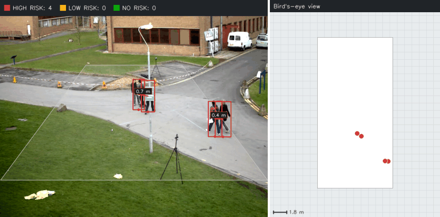
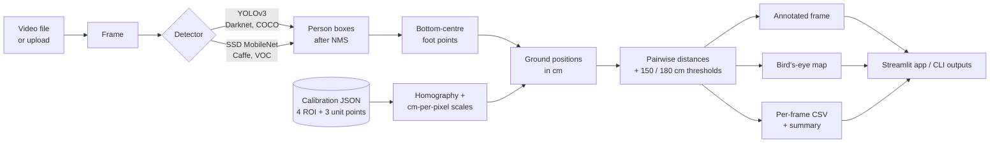
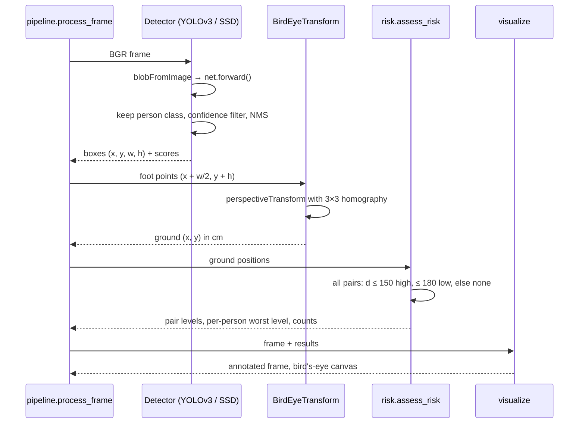
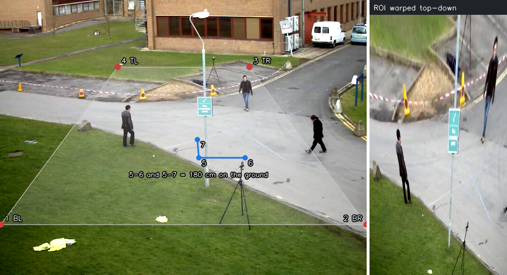
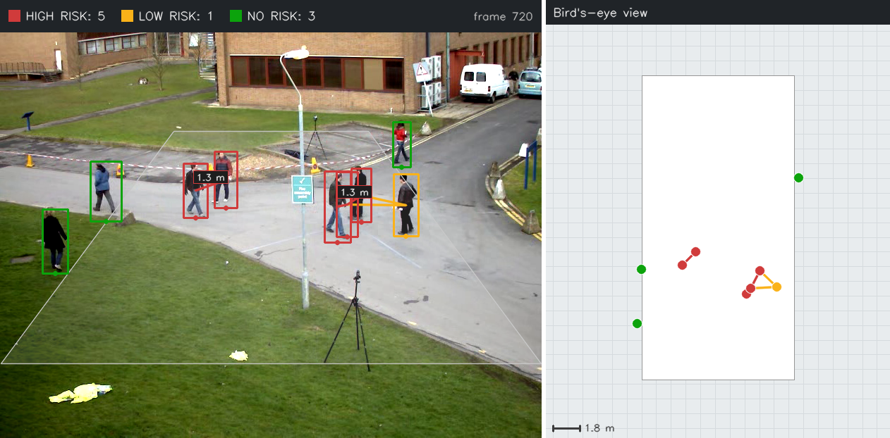
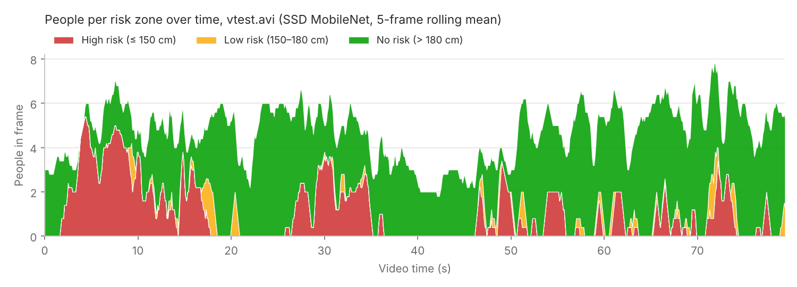
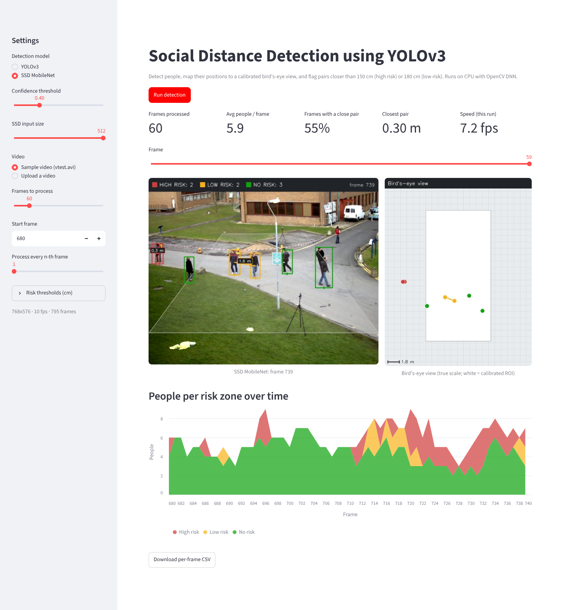

# 🚶 Social Distance Detection using YOLOv3

**A computer-vision system that finds people in CCTV-style video, maps where they stand onto a calibrated bird's-eye view of the ground, measures the real distance between every pair in centimetres, and flags each person as high, low or no risk. You can run it with YOLOv3 or SSD MobileNet from a Streamlit app.**


[](https://colab.research.google.com/github/aish-19shanbhag/social-distance-detection/blob/main/notebooks/social_distance_walkthrough.ipynb)

| | |
|---|---|
| **Problem** | In a camera image, people further away look closer together, so pixel distance is the wrong measure. The goal is to measure real distances between people in video and flag anyone standing too close |
| **Approach** | Pre-trained person detector (YOLOv3 or SSD MobileNet) → foot point of each box → perspective transform to a bird's-eye ground plane → calibrated Euclidean distance in cm → risk zones |
| **Risk zones** | **High** ≤ 150 cm · **Low** 150–180 cm · **None** > 180 cm (each person takes their worst pair) |
| **Speed (measured here)** | SSD MobileNet on a 2-thread CPU: **27.7 fps** at 300×300 input, **11.2 fps** at 512×512 (detection + mapping + risk) |
| **Interface** | Streamlit app (choose the model, sample or uploaded video, browse frames, risk chart, CSV export) plus a command-line tool |
| **Role** | Solo project, Jan 2021 – May 2021; rebuilt in 2026 as a tested, reproducible package |

<p align="center">
  
  <br><sub>The pipeline running on OpenCV's <code>vtest.avi</code> sample (frames 36–85). Left: camera view with boxes coloured by risk and lines between close pairs. Right: the same people on the true-scale bird's-eye map. Generated with the SSD MobileNet detector (see <a href="#results">Results</a>).</sub>
</p>

---

## Highlights

- **Two detectors behind one interface:** YOLOv3 (Darknet, COCO) and SSD MobileNet (Caffe, PASCAL VOC), both run on CPU through OpenCV's DNN module. You pick one in the Streamlit app or with a CLI flag.
- **Real distances, not pixel distances:** a 4-point homography warps the walkway into a top-down view, and 3 reference points set the centimetre scale both across and in depth.
- **Per-person risk:** all pairwise distances are computed every frame. Each person is coloured by their closest neighbour: red ≤ 150 cm, amber 150–180 cm, green > 180 cm.
- **Fast on a laptop-class CPU:** about 28 fps with SSD at 300×300 and 11 fps at 512×512, measured on this machine. Both are faster than the 10 fps sample video.
- **Full outputs:** annotated video, bird's-eye video, a per-frame CSV (people, risk counts, closest pair, timings) and a JSON summary.
- **Tested:** 43 pytest tests cover the homography, cm scaling, threshold boundaries, risk counting, NMS for both detector output formats, config loading, the video pipeline and the Streamlit app.

## ✨ Key features

| | Feature | What it does |
|---|---|---|
| 🎯 | **Person detection** | YOLOv3 at 416×416 (confidence 0.5, NMS 0.5) or SSD MobileNet at 300/512 (confidence 0.4, NMS 0.5). Only people are kept |
| 🦶 | **Ground contact point** | Uses the bottom-centre of each box, where the person stands, not the box centre |
| 🗺️ | **Bird's-eye mapping** | A homography from 4 ground points takes the camera view to a top-down plane |
| 📏 | **Calibrated distance** | 3 unit points (180 cm across, 180 cm in depth) convert warped pixels to centimetres on both axes |
| 🚦 | **Risk zones** | High / low / no risk for every pair and every person, with per-frame counts |
| 🖼️ | **Visual output** | Risk-coloured boxes, distance tags on close pairs, a true-scale map with a 1 m grid and a summary banner |
| 🧭 | **Calibration tool** | Click the points on the first frame, as in the 2021 version, or load them from JSON |
| 🖥️ | **Streamlit app** | Choose the model and video, process N frames, scrub through results, see a risk chart over time, download the CSV |
| ✅ | **Reproducible** | Every demo image, the GIF and the speed numbers come from one script. Tests run with no model weights |

## Why it matters

In 2021, keeping 6 feet (about 180 cm) apart was public-health guidance. Checking it by hand across many camera feeds isn't practical, and a naive pixel distance gets it wrong: two people 1 m apart near the camera can be further apart *in pixels* than two people 3 m apart at the back of the scene. This project solves that with **perspective geometry**. The same building blocks (detection, ground-plane mapping, metric distances) are used today for crowd-density monitoring, queue and occupancy analytics, and workplace safety zones.

---

## Architecture



## How one frame is processed



## Calibration: from pixels to centimetres

<p align="center"></p>

1. **Region of interest (points 1–4):** four points on the ground that form a rectangle *in the real world* (bottom-left, bottom-right, top-right, top-left). The homography maps this trapezoid to a rectangle, which is the bird's-eye view (right image above).
2. **Unit length (points 5–7):** points 5→6 are 180 cm apart across the scene and points 5→7 are 180 cm apart in depth. After warping, these give two scales: `cm_per_px_w = 180 / |w5 − w6|` and `cm_per_px_h = 180 / |w5 − w7|`. The scales differ because the warp stretches depth more than width.
3. **Distance:** for two people at warped positions *(x₁, y₁)* and *(x₂, y₂)*,
   `d = √[((x₁−x₂)·cm_per_px_w)² + ((y₁−y₂)·cm_per_px_h)²]`.

Calibrate a new camera once by clicking the points (`python -m socialdistance calibrate ...`, which opens an OpenCV window), or type the 7 points into a JSON file. **The sample video's calibration is approximate.** No ground measurements exist for that scene, so the scale was estimated from the apparent height of pedestrians (assumed to be about 170 cm) at different image rows, plus an assumed camera field of view. The method is explained in [`config/vtest_calibration.json`](config/vtest_calibration.json).

## Risk classification

| Pair distance | Risk | Colour | Meaning |
|---|---|---|---|
| d ≤ 150 cm | **High** | 🔴 red | Clearly inside the 6 ft guideline |
| 150 cm < d ≤ 180 cm | **Low** | 🟡 amber | Borderline: within 6 ft but more than 1.5 m |
| d > 180 cm | **None** | 🟢 green | Beyond 6 ft |

A person takes the **worst** level over all of their pairs, and a person alone is "no risk". Thresholds can be changed (`--high-cm`, `--low-cm`, or the sidebar in the app).

---

## Results

> **All demo media in this README were generated with the SSD MobileNet detector.** The YOLOv3 weights (~248 MB) have to be downloaded separately from pjreddie.com with `scripts/download_models.py`, and they couldn't be downloaded in the environment where these assets were built. The YOLOv3 code path is the same apart from the detector, and its post-processing is unit-tested with synthetic network outputs.

### Annotated frame and bird's-eye view

<p align="center"></p>

Frame 720 of `vtest.avi`: a pair 1.3 m apart and a group of three (0.5–1.3 m apart) are flagged high risk (red). The person next to that group is 1.6–1.75 m from two of its members, so they are low risk (amber). On the map, people outside the calibrated rectangle (white) are still measured, because the homography covers the whole ground plane.

### Risk over the whole video

<p align="center"></p>

Full run over all **795 frames** with SSD MobileNet at 512×512, using the approximate calibration: on average **4.7 people detected per frame** (at most 9), and **372 frames (47%)** had at least one pair closer than 180 cm. These are pipeline outputs, not accuracy measurements: no ground-truth distances exist for this video. Per-frame values are in [`reports/metrics/vtest_risk_counts.csv`](reports/metrics/vtest_risk_counts.csv).

### Processing speed (measured on this machine)

CPU only, 2 threads, OpenCV 4.14, Python 3.13, 768×576 frames, mean over 200 frames after 5 warm-up frames ([`reports/metrics/speed.json`](reports/metrics/speed.json)):

| Detector | Input | Network forward | Pipeline (detect + map + risk) | + drawing | People detected / frame |
|---|---|---|---|---|---|
| SSD MobileNet | 300×300 | 34.9 ms | **27.7 fps** | 25.1 fps | 1.47 |
| SSD MobileNet | 512×512 | 86.6 ms | **11.2 fps** | 10.8 fps | 4.85 |
| YOLOv3 | 416×416 | not measured (weights unavailable in the build environment) | | | |

The 512 input finds about 3× more of the small, distant pedestrians, so it is the default. The full 795-frame run, including drawing and writing two MP4 files, ran at **8.2 fps** end to end. Timings vary by a few fps between runs on a shared machine.

### Interactive demo

<p align="center"></p>

The app running headless (60 frames starting at frame 680, SSD MobileNet), captured with Playwright. If the YOLOv3 weights are missing, the app explains how to download them and disables the run button instead of failing ([screenshot](reports/screenshots/streamlit_yolo_weights_missing.png)).

### Results reported in the original 2021 project

The 2021 version of this project reported:

| Metric (as reported in 2021) | Value |
|---|---|
| Person detection accuracy, pre-trained YOLOv3 | 92% |
| Person detection accuracy, after transfer learning | 95% |
| Tracking accuracy for risk classification | 95% |

**The evaluation scripts, the labelled data and the transfer-learning code from 2021 are not in this repository** (the original repository didn't contain them either), so these figures can't be reproduced from this code. Treat them as reported, not verified here. The current pipeline uses the public pre-trained weights and analyses each frame independently (no identity tracking across frames).

---

## What changed from the 2021 version

The original code is kept unchanged in [`legacy/`](legacy/) for transparency.

| 2021 | 2026 rebuild |
|---|---|
| Separate YOLO and SSD scripts. The SSD script estimated distance from box height, not from the bird's-eye view | Both detectors share one interface and one perspective-based distance pipeline |
| SSD had no NMS | NMS for both detectors |
| Calibration clicked on every run (the script waited for 8 clicks but used 7) | Calibration saved as JSON and reused. An optional click tool asks for exactly 7 points |
| Frames with no detections were skipped, and a person alone in the frame wasn't counted | Every frame is recorded; a lone person counts as "no risk" |
| Streamlit app launched scripts as subprocesses | The app imports the package directly and shows frames, the map, a risk chart and a CSV |
| Hard-coded paths, no tests | Installable package, CLI, 43 tests, Colab notebook, a reproducible asset script |

## 🧰 Tech stack

| Layer | Tools |
|---|---|
| Language | Python 3.9+ |
| Detection | YOLOv3 (Darknet weights), MobileNet-SSD (Caffe weights), OpenCV DNN (CPU) |
| Geometry | OpenCV `getPerspectiveTransform` / `perspectiveTransform`, NumPy |
| Data and charts | pandas, Matplotlib |
| App | Streamlit (tested with `streamlit.testing.v1.AppTest`) |
| Media | OpenCV video I/O, Pillow (GIF) |
| Testing | pytest |
| Notebook | Jupyter / Google Colab |

## 🧠 Concepts demonstrated

- Object detection with pre-trained one-stage detectors (YOLOv3, SSD) and their output decoding
- Confidence filtering and non-maximum suppression
- Projective geometry: homographies, inverse perspective mapping, bird's-eye view
- Metric calibration from reference points with separate horizontal and depth scales
- Pairwise distance computation and rule-based risk classification
- Video processing pipelines with per-frame logging and throughput measurement
- Building an interactive ML demo with graceful handling of missing model files
- Testing CV code without model weights (synthetic network outputs, known homographies)

## Repository structure

```
social-distance-detection/
├── app/
│   └── streamlit_app.py           # interactive demo
├── config/
│   └── vtest_calibration.json     # approximate calibration for the sample video
├── data/
│   ├── vtest.avi                  # OpenCV sample pedestrian video (8.1 MB)
│   └── README.md                  # source and license
├── legacy/                        # original 2021 code, unchanged
├── models/
│   └── README.md                  # weights are downloaded here, not committed
├── notebooks/
│   └── social_distance_walkthrough.ipynb   # one-click Colab run
├── reports/
│   ├── demo/                      # GIF, frames, calibration figure, risk chart
│   ├── metrics/                   # speed.json, per-frame CSV, run summary
│   └── screenshots/               # Streamlit screenshots
├── scripts/
│   ├── download_models.py         # fetch YOLOv3 + SSD files into models/
│   └── make_demo_assets.py        # regenerate every figure and speed number
├── src/socialdistance/
│   ├── detectors.py               # YOLOv3 + SSD detectors, post-processing, NMS
│   ├── calibration.py             # calibration JSON + interactive click tool
│   ├── perspective.py             # homography, bird's-eye mapping, cm scales
│   ├── risk.py                    # pairwise distances, thresholds, counts
│   ├── visualize.py               # annotated frame, bird's-eye canvas, banner
│   ├── pipeline.py                # frame / video processing, CSV + videos
│   └── cli.py                     # python -m socialdistance {run, calibrate}
├── tests/                         # 43 pytest tests
├── pyproject.toml
└── requirements.txt
```

## Getting started

**In the browser, no installation:** click **Open in Colab** at the top, then **Runtime > Run all**.

**Locally:**

```bash
git clone https://github.com/aish-19shanbhag/social-distance-detection.git
cd social-distance-detection
pip install -r requirements.txt
pip install -e .

python scripts/download_models.py               # YOLOv3 (~248 MB) + SSD MobileNet (~23 MB)
# or: python scripts/download_models.py --ssd-only

# process the sample video (writes outputs/vtest/annotated.mp4, birds_eye.mp4, risk_counts.csv, summary.json)
python -m socialdistance run --video data/vtest.avi --config config/vtest_calibration.json \
    --detector yolov3 --output outputs/vtest

streamlit run app/streamlit_app.py               # interactive demo
pytest -q                                        # tests (no weights needed)
python scripts/make_demo_assets.py               # regenerate the figures and speed numbers in reports/
```

**Your own camera:** `python -m socialdistance calibrate --video my.mp4 --out config/my_scene.json` (needs a desktop session and `opencv-python`), then run with `--config config/my_scene.json`.

> OpenCV is pinned to 4.x (`opencv-python>=4.8,<5`) because OpenCV 5 removed the Caffe importer that SSD MobileNet needs.

## Limitations

- **Calibration sets the accuracy.** Distances are only as good as the 7 reference points. The sample video's calibration is estimated, not measured, so its distances may be off by tens of centimetres, more at the back of the scene. A real deployment should measure the ground rectangle on site.
- **Flat ground, fixed camera.** The homography assumes a single flat ground plane and a camera that doesn't move. Slopes, stairs or a panning camera break the mapping.
- **Occlusion and missed detections.** People hidden behind others or far from the camera can be missed (SSD at 300×300 finds about 1.5 people per frame on the sample, against about 4.9 at 512×512). A box cut off by occlusion moves the foot point and with it the distance.
- **Groups and households.** People who live together or walk as a group are flagged as high risk. The system measures proximity; it can't tell whether that proximity matters.
- **Camera angle.** Very low angles squeeze depth into a few pixel rows, so small box errors become large distance errors. High, angled views like the sample work best.
- **No tracking.** Each frame is analysed independently, so the counts can flicker when a detection drops for a frame.
- **Context.** The 150 / 180 cm thresholds come from COVID-19 guidance in 2021. The same pipeline applies to crowd-safety and occupancy analytics (people per square metre in a zone, queue spacing, keep-out areas around machinery) by changing the thresholds or the measure computed from the ground positions.

## Next steps

- Add **multi-object tracking** (SORT / DeepSORT) to give each person an ID, smooth the counts, and measure *how long* a pair stays close
- Swap in a **newer detector** (YOLOv8 / YOLO11 via ONNX in OpenCV DNN) and benchmark it against YOLOv3 and SSD on a labelled pedestrian set (for example MOT17)
- Build a **labelled evaluation set** with measured ground distances so distance error and risk-classification accuracy can be reported
- Group detection (people moving together across frames) to avoid flagging households
- Live RTSP camera input, plus density heatmaps for occupancy analytics

## Acknowledgements

- YOLOv3: Joseph Redmon and Ali Farhadi, *YOLOv3: An Incremental Improvement* (2018); weights from [pjreddie.com](https://pjreddie.com/darknet/yolo/)
- MobileNet-SSD Caffe model: [chuanqi305/MobileNet-SSD](https://github.com/chuanqi305/MobileNet-SSD)
- Sample video: `vtest.avi` from the [OpenCV](https://github.com/opencv/opencv) sample data (see [`data/README.md`](data/README.md))

## Author

**Aishwarya Ramanath Shanbhag**, MS Computer Science, San José State University
[GitHub](https://github.com/aish-19shanbhag) · [LinkedIn](https://www.linkedin.com/in/aishwarya-ramanath-shanbhag-452255185/) · [Portfolio](https://aish-19shanbhag.github.io/)
